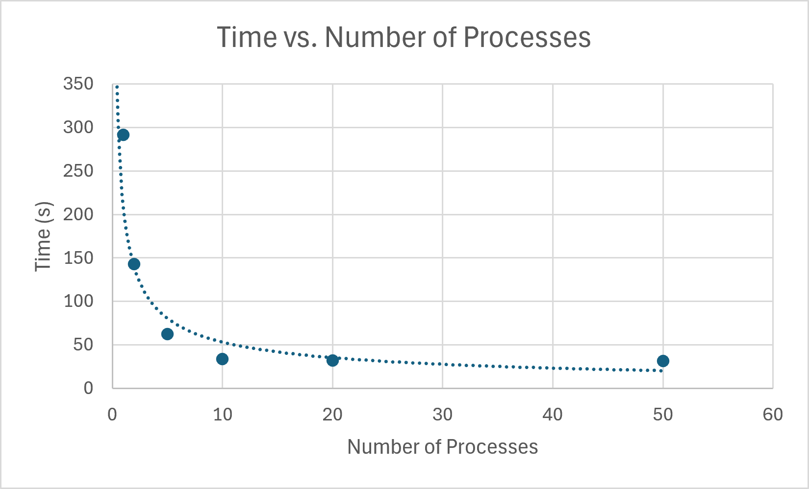

# CPE2600_Fractal_Lab
Labs 11 and 12 for systems programming

## Lab 11: Multi-processing

Compile using makefile (make command)

Run with ./mandelmovie -n maxProcesses

Resulting images are stored in a new folder called 'images' in the form mandel%d.jpg where %d is the image number

### Implementation

The program starts by parsing the -n argument to determine the largest amount of processes it should run at a time. Then, a semaphore is opened, starting at this value. The main program waits for the semaphore before making a child that executes the mandel program. This happens 50 times so that 50 images are created.

### Time vs. Processes Graph

The graph shows a very large speedup when going from 1 to 2 processes and 2 to 5 processes. By 10 processes the points start to settle and hover around 30 seconds.

## Lab 12: Multi-threading

To support multiple threads, the mandelmovie and mandel program now accept a -t argument for the number of threads to use. The compute_image function splits the total pixels in the image into multiple sections so that each section can be processed in a seperate thread. The threads are stored in an array as well as the imgSection structs that are passed into each each thread. An imgSection contains data about the image as well as the first pixel and final pixel that a certain thread should process. Once all threads are done, sem_post is called and a new image can be created.

### Processes and Threads Table

| | | | | Num Procs | | | |
|-| - | - | - | - | - | -- | -- |
| |   | 1 | 2 | 5 | 8 | 12 | 20 |
| | 1 | 166.63s | 94.97s | 47.08s | 30.62s | 22.76s | 20.49s |
| | 2 | 80.92s | 49.95s | 23.79s | 19.76s | 18.88s | 19.36s |
|Num threads | 5 | 35.30s | 21.57s | 19.12s | 17.84s | 17.39s | 16.02s |
| | 8 | 24.14s | 16.95s | 18.02s | 17.48s | 17.84s | 17.79s |
| | 12 | 19.03s | 19.22s | 18.75s | 17.12s | 17.28s | 17.32s |
| | 20 | 17.93s | 18.37s | 18.37s | 18.18s | 18.66s | 18.63s |
| | 50 | 17.35s | 18.39s | 18.33s | 18.54s | 19.18s | 17.99s |

### Which technique seemed to impact runtime more – multithreading or multiprocessing. Why do you think that is?

### Was there a “sweet spot” where optimal (minimal) runtime was achieved?